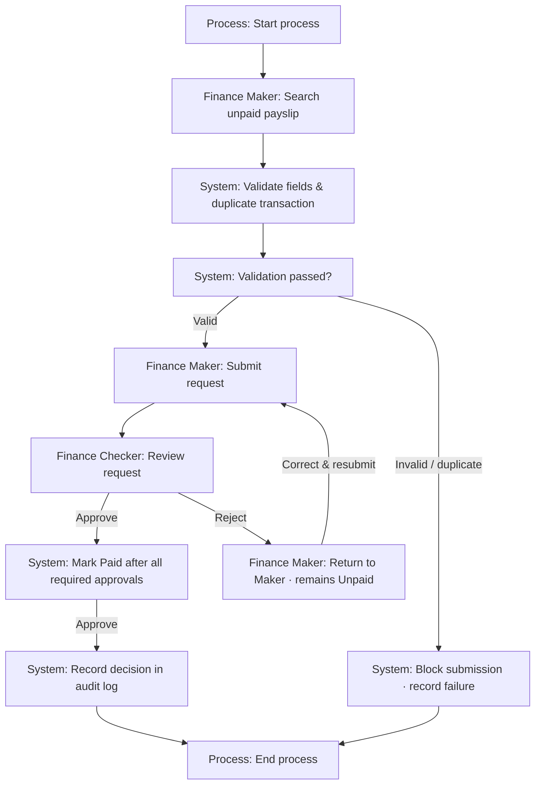

# Payment approval — Software Requirements Specification

Draft for review · Based on the supplied SRS Template

| Field | Value | Title / Role | Signature / Status |
| --- | --- | --- | --- |
| Title | Payment approval |  |  |
| CR ID | TBD |  |  |
| JIRA ID | TBD |  |  |
| Created by | TBD | Business Analyst | Pending sign-off |
| Reviewed by | TBD | BA Lead | Pending sign-off |
| Approved by | TBD — confirm stakeholders | Client / Stakeholder | Pending sign-off |

## Revision History

| Date | Version | Created by | Description of change | Affected Section |
| --- | --- | --- | --- | --- |
| TBD | 1.0 | TBD | Initial analysis draft | Features and Stories |

## Purpose

Describe the current implementation and proposed changes for Payment approval. Confirm the origin of the CR, its objective, and the expected user benefit with stakeholders.

## Users

- Finance Maker
- Finance Checker
- Finance Officer

## Scope of this CR

| Scope Identification | Description |
| --- | --- |
| In Scope | Payslip request submission Payment validation Request review and payment status Payment audit trail |
| Out of Scope | TBD — agree the excluded functionality. |

## Workflow

| Step ID | UML type | Role | Activity / Decision | Linked Requirements |
| --- | --- | --- | --- | --- |
| WF-01 | Activity | Finance Maker | Search unpaid payslip | BR-01 |
| WF-02 | Activity | System | Validate fields & duplicate transaction | BR-02, BR-03, BR-04, BR-07 |
| WF-03 | Activity | Finance Maker | Submit request | BR-01, BR-02, BR-05 |
| WF-04 | Decision | Finance Checker | Review request | BR-05, BR-07 |
| WF-05 | Decision | System | Mark Paid after all required approvals | BR-06 |
| WF-06 | Activity | System | Record decision in audit log | BR-04, BR-08 |
| WF-REJECT | Activity | Finance Maker | Return to Maker · remains Unpaid | BR-07 |
| WF-BLOCK | Activity | System | Block submission · record failure | BR-02, BR-04, BR-07 |
| WF-VALID | Decision | System | Validation passed? | BR-02, BR-03, BR-04, BR-07 |
| UML-START | Start | Process | Start process |  |
| UML-END | Activity final | Process | End process |  |

### Workflow connections

- WF-01 → WF-02
- WF-VALID → WF-03 — Valid
- WF-03 → WF-04
- WF-04 → WF-05 — Approve
- WF-05 → WF-06 — Approve
- WF-04 → WF-REJECT — Reject
- WF-REJECT → WF-03 — Correct & resubmit
- WF-VALID → WF-BLOCK — Invalid / duplicate
- WF-02 → WF-VALID
- UML-START → WF-01
- WF-06 → UML-END
- WF-BLOCK → UML-END

## Table of Contents

- List of Features & Stories
- Features
- 1. Payslip request submission | F01 | TBD
- 1.1. A Finance Maker can search for an unpaid payslip and submit a Mark as Paid … | US-01 | TBD
- 2. Payment validation | F02 | TBD
- 2.1. Payment method and payment date are mandatory before a request is submitted | US-02 | TBD
- 2.2. For a payslip amount greater than zero, payment method lists bank names only | US-03 | TBD
- 2.3. A duplicate transaction ID for the same bank must be blocked before submiss… | US-04 | TBD
- 3. Request review and payment status | F03 | TBD
- 3.1. A Finance Checker can approve or reject a submitted request | US-05 | TBD
- 3.2. A payslip becomes Paid only after the required approval is complete | US-06 | TBD
- 3.3. A rejected request remains Unpaid and returns to the Maker for correction a… | US-07 | TBD
- 4. Payment audit trail | F04 | TBD
- 4.1. The system records submissions, approval decisions, and validation failures… | US-08 | TBD
- Risk Analysis
- Change Effort Estimation
- Effort Estimation
- CR Accumulation

## List of Features & Stories

| Type | Feature / Epic ID | Title | Story ID | JIRA ID | Story Title |
| --- | --- | --- | --- | --- | --- |
| Feature | F01 | Payslip request submission | US-01 | TBD | A Finance Maker can search for an unpaid payslip and submit a Mark as Paid … |
| Feature | F02 | Payment validation | US-02 | TBD | Payment method and payment date are mandatory before a request is submitted |
| Feature | F02 | Payment validation | US-03 | TBD | For a payslip amount greater than zero, payment method lists bank names only |
| Feature | F02 | Payment validation | US-04 | TBD | A duplicate transaction ID for the same bank must be blocked before submiss… |
| Feature | F03 | Request review and payment status | US-05 | TBD | A Finance Checker can approve or reject a submitted request |
| Feature | F03 | Request review and payment status | US-06 | TBD | A payslip becomes Paid only after the required approval is complete |
| Feature | F03 | Request review and payment status | US-07 | TBD | A rejected request remains Unpaid and returns to the Maker for correction a… |
| Feature | F04 | Payment audit trail | US-08 | TBD | The system records submissions, approval decisions, and validation failures… |

## Features

### 1. Payslip request submission | F01 | TBD

Type: Feature · Project: Payment approval

#### 1.1. A Finance Maker can search for an unpaid payslip and submit a Mark as Paid … | US-01 | TBD

**1. User Story:**

As a Finance Maker, I want to submit a Mark as Paid request for an unpaid payslip, so I can request payment confirmation without resubmitting a paid payslip.

**2. User Journey:**

1. Finance Maker: Search unpaid payslip
2. Finance Maker: Submit request

**3. Actors:**

- Finance Maker

**4. Scope:**

- Business rule BR-01: A Finance Maker can search for an unpaid payslip and submit a Mark as Paid …

**5. Pre-condition:**

- The relevant payslip is Unpaid.

**6. Impacted Areas:**

- Pages: TBD — confirm impacted screens.
- Reports: TBD — confirm impacted reports.
- Workflow: WF-01 — Search unpaid payslip
- Workflow: WF-03 — Submit request

**7. Mock-up/ Prototypes:**

TBD — attach a mock-up or enter a prototype URL.

**8. Requirements:**

1. BR-01: A Finance Maker can search for an unpaid payslip and submit a Mark as Paid request. Paid payslips cannot be submitted again.

**9. Acceptance Criteria:**

1. Given an authorized Finance Maker, when this capability is used, then the following rule is enforced: A Finance Maker can search for an unpaid payslip and submit a Mark as Paid request. Paid payslips cannot be submitted again.

**10. Exceptions:**

- Paid payslips cannot be submitted again.

Source requirements: BR-01 · UML steps: WF-01, WF-03 · Parent feature / epic: F01

### 2. Payment validation | F02 | TBD

Type: Feature · Project: Payment approval

#### 2.1. Payment method and payment date are mandatory before a request is submitted | US-02 | TBD

**1. User Story:**

As a Finance Maker, I want to provide a payment method and a valid payment date, so I can submit a complete payment request.

**2. User Journey:**

1. System: Validate fields & duplicate transaction
2. Finance Maker: Submit request
3. System: Block submission · record failure
4. System: Validation passed?

**3. Actors:**

- Finance Maker
- System

**4. Scope:**

- Business rule BR-02: Payment method and payment date are mandatory before a request is submitted

**5. Pre-condition:**

- TBD — confirm the starting state and access permissions.

**6. Impacted Areas:**

- Pages: TBD — confirm impacted screens.
- Reports: TBD — confirm impacted reports.
- Workflow: WF-02 — Validate fields & duplicate transaction
- Workflow: WF-03 — Submit request
- Workflow: WF-BLOCK — Block submission · record failure
- Workflow: WF-VALID — Validation passed?

**7. Mock-up/ Prototypes:**

TBD — attach a mock-up or enter a prototype URL.

**8. Requirements:**

1. BR-02: Payment method and payment date are mandatory before a request is submitted. A payment date must be a valid calendar date.

**9. Acceptance Criteria:**

1. Given an authorized Finance Officer, when this capability is used, then the following rule is enforced: Payment method and payment date are mandatory before a request is submitted. A payment date must be a valid calendar date.
2. Given a required field is missing, when the user submits, then submission is blocked and the missing field is identified.

**10. Exceptions:**

- TBD — complete during requirements review.

Source requirements: BR-02 · UML steps: WF-02, WF-03, WF-BLOCK, WF-VALID · Parent feature / epic: F02

#### 2.2. For a payslip amount greater than zero, payment method lists bank names only | US-03 | TBD

**1. User Story:**

As a Finance Maker, I want to choose a payment method that matches the payslip amount, so I can record the applicable bank payment or zero-amount adjustment.

**2. User Journey:**

1. System: Validate fields & duplicate transaction
2. System: Validation passed?

**3. Actors:**

- Finance Maker
- System

**4. Scope:**

- Business rule BR-03: For a payslip amount greater than zero, payment method lists bank names only

**5. Pre-condition:**

- TBD — confirm the starting state and access permissions.

**6. Impacted Areas:**

- Pages: TBD — confirm impacted screens.
- Reports: TBD — confirm impacted reports.
- Workflow: WF-02 — Validate fields & duplicate transaction
- Workflow: WF-VALID — Validation passed?

**7. Mock-up/ Prototypes:**

TBD — attach a mock-up or enter a prototype URL.

**8. Requirements:**

1. BR-03: For a payslip amount greater than zero, payment method lists bank names only. For a zero amount, it lists Previous Advance, Scholarship & Waiver, and Semester Drop.

**9. Acceptance Criteria:**

1. Given an authorized Finance Officer, when this capability is used, then the following rule is enforced: For a payslip amount greater than zero, payment method lists bank names only. For a zero amount, it lists Previous Advance, Scholarship & Waiver, and Semester Drop.
2. Given an amount of 0, then only Previous Advance, Scholarship & Waiver, and Semester Drop are offered; given an amount above 0, then only bank names are offered.

**10. Exceptions:**

- TBD — complete during requirements review.

Source requirements: BR-03 · UML steps: WF-02, WF-VALID · Parent feature / epic: F02

#### 2.3. A duplicate transaction ID for the same bank must be blocked before submiss… | US-04 | TBD

**1. User Story:**

As a Finance Maker, I want to have duplicate bank transactions blocked before submission, so I can avoid creating duplicate payment requests.

**2. User Journey:**

1. System: Validate fields & duplicate transaction
2. System: Record decision in audit log
3. System: Block submission · record failure
4. System: Validation passed?

**3. Actors:**

- Finance Maker
- System

**4. Scope:**

- Business rule BR-04: A duplicate transaction ID for the same bank must be blocked before submiss…

**5. Pre-condition:**

- TBD — confirm the starting state and access permissions.

**6. Impacted Areas:**

- Pages: TBD — confirm impacted screens.
- Reports: TBD — confirm impacted reports.
- Workflow: WF-02 — Validate fields & duplicate transaction
- Workflow: WF-06 — Record decision in audit log
- Workflow: WF-BLOCK — Block submission · record failure
- Workflow: WF-VALID — Validation passed?

**7. Mock-up/ Prototypes:**

TBD — attach a mock-up or enter a prototype URL.

**8. Requirements:**

1. BR-04: A duplicate transaction ID for the same bank must be blocked before submission, with a failure recorded in the audit log.

**9. Acceptance Criteria:**

1. Given an authorized Business user, when this capability is used, then the following rule is enforced: A duplicate transaction ID for the same bank must be blocked before submission, with a failure recorded in the audit log.
2. Given an existing bank and transaction ID pair, when the same pair is submitted again, then no duplicate request is created and the failure is logged.

**10. Exceptions:**

- A duplicate transaction ID for the same bank must be blocked before submission, with a failure recorded in the audit log.

Source requirements: BR-04 · UML steps: WF-02, WF-06, WF-BLOCK, WF-VALID · Parent feature / epic: F02

### 3. Request review and payment status | F03 | TBD

Type: Feature · Project: Payment approval

#### 3.1. A Finance Checker can approve or reject a submitted request | US-05 | TBD

**1. User Story:**

As a Finance Checker, I want to approve or reject a submitted payment request, so I can control whether the request proceeds to completion.

**2. User Journey:**

1. Finance Maker: Submit request
2. Finance Checker: Review request

**3. Actors:**

- Finance Checker
- Finance Maker

**4. Scope:**

- Business rule BR-05: A Finance Checker can approve or reject a submitted request

**5. Pre-condition:**

- A submitted request exists.

**6. Impacted Areas:**

- Pages: TBD — confirm impacted screens.
- Reports: TBD — confirm impacted reports.
- Workflow: WF-03 — Submit request
- Workflow: WF-04 — Review request

**7. Mock-up/ Prototypes:**

TBD — attach a mock-up or enter a prototype URL.

**8. Requirements:**

1. BR-05: A Finance Checker can approve or reject a submitted request. The Maker cannot approve their own request.

**9. Acceptance Criteria:**

1. Given an authorized Finance Checker, when this capability is used, then the following rule is enforced: A Finance Checker can approve or reject a submitted request. The Maker cannot approve their own request.
2. Given the current user created the request, when they attempt to approve it, then approval is denied.

**10. Exceptions:**

- The Maker cannot approve their own request.

Source requirements: BR-05 · UML steps: WF-03, WF-04 · Parent feature / epic: F03

#### 3.2. A payslip becomes Paid only after the required approval is complete | US-06 | TBD

**1. User Story:**

As a Finance Officer, I want to see a payslip marked Paid only after all required approvals, so I can identify whether the approval process is complete.

**2. User Journey:**

1. System: Mark Paid after all required approvals

**3. Actors:**

- Finance Officer
- System

**4. Scope:**

- Business rule BR-06: A payslip becomes Paid only after the required approval is complete

**5. Pre-condition:**

- TBD — confirm the starting state and access permissions.

**6. Impacted Areas:**

- Pages: TBD — confirm impacted screens.
- Reports: TBD — confirm impacted reports.
- Workflow: WF-05 — Mark Paid after all required approvals

**7. Mock-up/ Prototypes:**

TBD — attach a mock-up or enter a prototype URL.

**8. Requirements:**

1. BR-06: A payslip becomes Paid only after the required approval is complete. Until then, its payment status remains Unpaid.

**9. Acceptance Criteria:**

1. Given an authorized Finance Checker, when this capability is used, then the following rule is enforced: A payslip becomes Paid only after the required approval is complete. Until then, its payment status remains Unpaid.
2. Given an approval is still pending or the request is rejected, then the payslip must remain Unpaid.

**10. Exceptions:**

- TBD — complete during requirements review.

Source requirements: BR-06 · UML steps: WF-05 · Parent feature / epic: F03

#### 3.3. A rejected request remains Unpaid and returns to the Maker for correction a… | US-07 | TBD

**1. User Story:**

As a Finance Maker, I want to correct and resubmit a rejected request, so I can continue the payment confirmation process.

**2. User Journey:**

1. System: Validate fields & duplicate transaction
2. Finance Checker: Review request
3. Finance Maker: Return to Maker · remains Unpaid
4. System: Block submission · record failure
5. System: Validation passed?

**3. Actors:**

- Finance Maker
- System
- Finance Checker

**4. Scope:**

- Business rule BR-07: A rejected request remains Unpaid and returns to the Maker for correction a…

**5. Pre-condition:**

- TBD — confirm the starting state and access permissions.

**6. Impacted Areas:**

- Pages: TBD — confirm impacted screens.
- Reports: TBD — confirm impacted reports.
- Workflow: WF-02 — Validate fields & duplicate transaction
- Workflow: WF-04 — Review request
- Workflow: WF-REJECT — Return to Maker · remains Unpaid
- Workflow: WF-BLOCK — Block submission · record failure
- Workflow: WF-VALID — Validation passed?

**7. Mock-up/ Prototypes:**

TBD — attach a mock-up or enter a prototype URL.

**8. Requirements:**

1. BR-07: A rejected request remains Unpaid and returns to the Maker for correction and resubmission. A rejection reason is mandatory.

**9. Acceptance Criteria:**

1. Given an authorized Finance Checker, when this capability is used, then the following rule is enforced: A rejected request remains Unpaid and returns to the Maker for correction and resubmission. A rejection reason is mandatory.
2. Given a required field is missing, when the user submits, then submission is blocked and the missing field is identified.
3. Given a rejection reason is empty, when Reject is selected, then rejection is blocked; with a reason, the request returns to the Maker and remains Unpaid.

**10. Exceptions:**

- A rejected request remains Unpaid and returns to the Maker for correction and resubmission.
- A rejection reason is mandatory.

Source requirements: BR-07 · UML steps: WF-02, WF-04, WF-REJECT, WF-BLOCK, WF-VALID · Parent feature / epic: F03

### 4. Payment audit trail | F04 | TBD

Type: Feature · Project: Payment approval

#### 4.1. The system records submissions, approval decisions, and validation failures… | US-08 | TBD

**1. User Story:**

As a Finance Officer, I want to have submissions, decisions, and validation failures recorded, so I can trace the actor, timestamp, payslip, and changed values.

**2. User Journey:**

1. System: Record decision in audit log

**3. Actors:**

- Finance Officer
- System

**4. Scope:**

- Business rule BR-08: The system records submissions, approval decisions, and validation failures…

**5. Pre-condition:**

- TBD — confirm the starting state and access permissions.

**6. Impacted Areas:**

- Pages: TBD — confirm impacted screens.
- Reports: TBD — confirm impacted reports.
- Workflow: WF-06 — Record decision in audit log

**7. Mock-up/ Prototypes:**

TBD — attach a mock-up or enter a prototype URL.

**8. Requirements:**

1. BR-08: The system records submissions, approval decisions, and validation failures with the actor, timestamp, payslip number, and changed values in an audit log.

**9. Acceptance Criteria:**

1. Given an authorized Finance Checker, when this capability is used, then the following rule is enforced: The system records submissions, approval decisions, and validation failures with the actor, timestamp, payslip number, and changed values in an audit log.

**10. Exceptions:**

- TBD — complete during requirements review.

Source requirements: BR-08 · UML steps: WF-06 · Parent feature / epic: F04

## Risk Analysis

| SL | Risk | Level (High/Medium/Low) | Likelihood of Event | Mitigation Plan |
| --- | --- | --- | --- | --- |
| 1 | Unreviewed or ambiguous business rules | TBD | TBD | Review each rule and its acceptance criteria with the requirement owner. |
| 2 | Missed downstream change impacts | TBD | TBD | Validate requirement, workflow, feature, story, page, and report links. |

## Change Effort Estimation

### 1. Effort Estimation

Unit: Days. Confirm the billing basis before approval.

| SL | Item | Days |
| --- | --- | --- |
| 1 | Project Management | TBD |
| 2 | Business Analysis | TBD |
| 3 | Development | TBD |
| 4 | SQA | TBD |
| 5 | Implementation | TBD |
|  | Total | TBD |

### 2. CR Accumulation

| Field | Value |
| --- | --- |
| CR Initiated by | TBD |
| CR Initiated on | TBD |
| Type of CR | TBD |
| Category of CR | TBD |
| Accumulation (%) | TBD |

Note: Confirm the approved AMC accumulation policy and estimation basis before sign-off.

## Appendix A. Business requirements

### BR-01 · A Finance Maker can search for an unpaid payslip and submit a Mark as Paid …

A Finance Maker can search for an unpaid payslip and submit a Mark as Paid request. Paid payslips cannot be submitted again.

Priority: Must · Needs review · Sources: SRC-01

### BR-02 · Payment method and payment date are mandatory before a request is submitted

Payment method and payment date are mandatory before a request is submitted. A payment date must be a valid calendar date.

Priority: Must · Needs review · Sources: SRC-02

### BR-03 · For a payslip amount greater than zero, payment method lists bank names only

For a payslip amount greater than zero, payment method lists bank names only. For a zero amount, it lists Previous Advance, Scholarship & Waiver, and Semester Drop.

Priority: Must · Needs review · Sources: SRC-03

### BR-04 · A duplicate transaction ID for the same bank must be blocked before submiss…

A duplicate transaction ID for the same bank must be blocked before submission, with a failure recorded in the audit log.

Priority: Must · Needs review · Sources: SRC-04

### BR-05 · A Finance Checker can approve or reject a submitted request

A Finance Checker can approve or reject a submitted request. The Maker cannot approve their own request.

Priority: Must · Needs review · Sources: SRC-05

### BR-06 · A payslip becomes Paid only after the required approval is complete

A payslip becomes Paid only after the required approval is complete. Until then, its payment status remains Unpaid.

Priority: Must · Needs review · Sources: SRC-06

### BR-07 · A rejected request remains Unpaid and returns to the Maker for correction a…

A rejected request remains Unpaid and returns to the Maker for correction and resubmission. A rejection reason is mandatory.

Priority: Must · Needs review · Sources: SRC-07

### BR-08 · The system records submissions, approval decisions, and validation failures…

The system records submissions, approval decisions, and validation failures with the actor, timestamp, payslip number, and changed values in an audit log.

Priority: Must · Needs review · Sources: SRC-08

## Appendix B. Traceability

| Source | Requirement | Type | Feature / Epic | Story | Workflow |
| --- | --- | --- | --- | --- | --- |
| SRC-01 | BR-01 | Feature | F01 | US-01 | WF-01, WF-03 |
| SRC-02 | BR-02 | Feature | F02 | US-02 | WF-02, WF-03, WF-BLOCK, WF-VALID |
| SRC-03 | BR-03 | Feature | F02 | US-03 | WF-02, WF-VALID |
| SRC-04 | BR-04 | Feature | F02 | US-04 | WF-02, WF-06, WF-BLOCK, WF-VALID |
| SRC-05 | BR-05 | Feature | F03 | US-05 | WF-03, WF-04 |
| SRC-06 | BR-06 | Feature | F03 | US-06 | WF-05 |
| SRC-07 | BR-07 | Feature | F03 | US-07 | WF-02, WF-04, WF-REJECT, WF-BLOCK, WF-VALID |
| SRC-08 | BR-08 | Feature | F04 | US-08 | WF-06 |

## Appendix C. Open questions

- What is the approval turnaround time?
- Are backdated payment dates permitted?
- Who can view the audit log, and how long is it retained?

## Appendix D. Meeting outcomes

- TBD — complete during requirements review.

## Appendix E. Source evidence

### SRC-01 · Business brief · paragraph 1

A Finance Maker can search for an unpaid payslip and submit a Mark as Paid request. Paid payslips cannot be submitted again.

### SRC-02 · Business brief · paragraph 2

Payment method and payment date are mandatory before a request is submitted. A payment date must be a valid calendar date.

### SRC-03 · Business brief · paragraph 3

For a payslip amount greater than zero, payment method lists bank names only. For a zero amount, it lists Previous Advance, Scholarship & Waiver, and Semester Drop.

### SRC-04 · Business brief · paragraph 4

A duplicate transaction ID for the same bank must be blocked before submission, with a failure recorded in the audit log.

### SRC-05 · Business brief · paragraph 5

A Finance Checker can approve or reject a submitted request. The Maker cannot approve their own request.

### SRC-06 · Business brief · paragraph 6

A payslip becomes Paid only after the required approval is complete. Until then, its payment status remains Unpaid.

### SRC-07 · Business brief · paragraph 7

A rejected request remains Unpaid and returns to the Maker for correction and resubmission. A rejection reason is mandatory.

### SRC-08 · Business brief · paragraph 8

The system records submissions, approval decisions, and validation failures with the actor, timestamp, payslip number, and changed values in an audit log.

## Appendix F. Story relationships

- TBD — complete during requirements review.

## Appendix G. Project knowledge

- TBD — complete during requirements review.